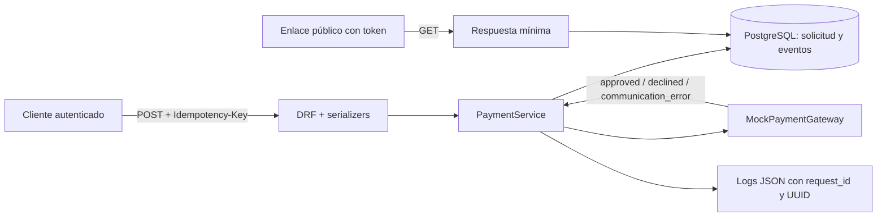

# PaymentFlow

PaymentFlow es un MVP de backend para crear y gestionar solicitudes de pago. Está diseñado como muestra técnica de arquitectura con Django: separa HTTP, casos de uso, persistencia, pasarela simulada, auditoría y observabilidad.

> **Aviso importante:** no procesa pagos reales ni recopila, transmite o almacena tarjetas, CVV u otros datos bancarios. La pasarela es exclusivamente simulada.

## Tecnologías

- Python 3.12 y Django 5.2 LTS.
- Django REST Framework.
- PostgreSQL 17 en Docker Compose.
- `psycopg` para la conexión PostgreSQL.
- `python-dotenv` para configuración local.
- Tests con `django.test` y el cliente de DRF.
- Tailwind CSS 3.4, compilado localmente para el dashboard Django.

## Arquitectura

```text
config/                         Configuración Django, logging y rutas
dashboard/                      Dashboard interno con templates, vistas y activos
scripts/                        Compilación reproducible de estilos Tailwind
payments/
├── gateways/                   Contrato de pasarela y MockPaymentGateway
├── management/commands/        seed_demo
├── migrations/                 Esquema versionado
├── services/                   Casos de uso transaccionales
├── tests/                      Tests de modelo, servicio, API y observabilidad
├── admin.py                    Consulta de solicitudes y eventos
├── middleware.py               Correlación HTTP mediante X-Request-ID
├── models.py                   PaymentRequest y PaymentEvent
├── serializers.py              Validación y representaciones HTTP
└── views.py                    Adaptadores HTTP delgados
compose.yaml                    PostgreSQL local
```

Las vistas validan y serializan; `PaymentService` concentra creación idempotente y transiciones. `PaymentRequest` es el registro de negocio y `PaymentEvent` conserva su historial. Los logs JSON son telemetría técnica, no una segunda fuente de verdad.

## Flujo de pago



## Instalación local

### 1. Variables de entorno

```powershell
Copy-Item .env.example .env
```

Edita `.env` y usa una contraseña local propia para `POSTGRES_PASSWORD` y una clave propia para `DJANGO_SECRET_KEY`. El archivo se ignora mediante Git y no debe publicarse.

> Este proyecto está configurado para desarrollo local. `.env.example` usa `DJANGO_DEBUG=True`; no reutilices esta configuración ni la clave de desarrollo en producción.

### 2. Entorno Python

```powershell
py -3.12 -m venv .venv
.\.venv\Scripts\Activate.ps1
python -m pip install -r requirements.txt
```

### 3. PostgreSQL local

```powershell
docker compose up -d postgres
docker compose ps
```

El puerto solo se publica en `127.0.0.1`. Los datos persisten en el volumen nombrado `postgres_data`, gestionado por Docker y fuera del repositorio.

### 4. Migraciones, usuario y servidor

```powershell
python manage.py migrate
python manage.py createsuperuser
python manage.py runserver
```

El panel Admin está en `http://127.0.0.1:8000/admin/`. La API navegable permite iniciar sesión en `http://127.0.0.1:8000/api-auth/login/` y redirige a `/api/payments/`.

## Dashboard web

El dashboard interno está disponible en `http://127.0.0.1:8000/dashboard/` y requiere un usuario autenticado con `is_staff`. Es independiente de Django Admin y utiliza los mismos modelos y `PaymentService`:

- **Overview:** métricas reales de PostgreSQL, actividad reciente y distribución por estado.
- **Payments:** búsqueda, filtro de estado, ordenación, paginación y contadores reales.
- **Payment detail:** importe, UUID, eventos de auditoría y simulaciones de desarrollo.
- **Create payment:** formulario con protección CSRF, feedback y clave idempotente generada para la solicitud.
- **Activity:** últimos eventos persistentes de auditoría.

El selector de tema incluye claro, oscuro y sistema; la preferencia persiste en `localStorage`. La interfaz respeta `prefers-reduced-motion` y no expone tokens públicos ni claves de idempotencia.

### Compilar estilos

Tras instalar las dependencias de Node, compila el CSS antes de arrancar Django:

```powershell
npm install
npm run build:css
```

Para desarrollo visual continuo:

```powershell
npm run watch:css
```

`node_modules/` está ignorado por Git. El CSS compilado sí se versiona para que el dashboard funcione tras clonar el proyecto sin exigir Node durante la ejecución de Django.

## Datos de demostración

```powershell
python manage.py seed_demo
```

El comando crea —sin borrar registros existentes— cinco solicitudes con referencias `DEMO-*`:

- aprobada;
- rechazada;
- pendiente;
- expirada;
- pendiente tras un error simulado de comunicación.

Las claves idempotentes, referencias y expiración son deterministas. Ejecutar el comando repetidamente no duplica solicitudes ni eventos de auditoría.

## Tests y comprobaciones

```powershell
python manage.py check
python manage.py makemigrations --check --dry-run
python manage.py migrate
python manage.py test
npm run build:css
```

## API REST

Los endpoints bajo `/api/` requieren un usuario con `is_staff`. Se puede usar sesión desde la API navegable o Basic Auth durante desarrollo. Las respuestas administrativas no incluyen el ID interno, token público, hash ni clave de idempotencia.

| Método | Ruta | Descripción |
|---|---|---|
| `POST` | `/api/payments/` | Crea una solicitud con `Idempotency-Key`. |
| `GET` | `/api/payments/` | Lista paginada de solicitudes. |
| `GET` | `/api/payments/{uuid}/` | Detalle administrativo. |
| `POST` | `/api/payments/{uuid}/process/` | Ejecuta la pasarela simulada. |
| `GET` | `/api/payments/{uuid}/events/` | Historial de auditoría. |
| `GET` | `/pay/{token}/` | Vista pública limitada. |

Estados: `PENDING`, `PAID`, `FAILED` y `EXPIRED`. Solo se permiten transiciones desde `PENDING` hacia uno de los otros tres estados.

### JSON de creación

```json
{
  "amount": "25.00",
  "currency": "EUR",
  "concept": "Suscripción de demostración",
  "reference": "DEMO-API-001"
}
```

La cabecera obligatoria es:

```text
Idempotency-Key: demo-api-create-001
```

### Ejemplos PowerShell

Primero solicita las credenciales de un superusuario sin escribirlas en el historial:

```powershell
$credential = Get-Credential
$encoded = [Convert]::ToBase64String(
  [Text.Encoding]::ASCII.GetBytes(
    "$($credential.UserName):$($credential.GetNetworkCredential().Password)"
  )
)
$authHeaders = @{ Authorization = "Basic $encoded" }
$baseUrl = "http://127.0.0.1:8000"
```

Crear una solicitud:

```powershell
$createHeaders = $authHeaders + @{ "Idempotency-Key" = "demo-api-create-001" }
$body = @{
  amount = "25.00"
  currency = "EUR"
  concept = "Suscripción de demostración"
  reference = "DEMO-API-001"
} | ConvertTo-Json

$payment = Invoke-RestMethod -Method Post `
  -Uri "$baseUrl/api/payments/" `
  -Headers $createHeaders `
  -ContentType "application/json" `
  -Body $body
$payment.uuid
```

Repetir exactamente la misma petición devuelve la misma solicitud (`200` en lugar de `201`):

```powershell
$samePayment = Invoke-RestMethod -Method Post `
  -Uri "$baseUrl/api/payments/" `
  -Headers $createHeaders `
  -ContentType "application/json" `
  -Body $body
```

Simular aprobación o rechazo:

```powershell
$approvedBody = @{ outcome = "approved" } | ConvertTo-Json
Invoke-RestMethod -Method Post `
  -Uri "$baseUrl/api/payments/$($payment.uuid)/process/" `
  -Headers $authHeaders `
  -ContentType "application/json" `
  -Body $approvedBody

# Para otro pago pendiente: @{ outcome = "declined" } | ConvertTo-Json
```

Consultar eventos:

```powershell
Invoke-RestMethod -Method Get `
  -Uri "$baseUrl/api/payments/$($payment.uuid)/events/" `
  -Headers $authHeaders
```

Para obtener un token de demostración, abre una solicitud `DEMO-*` en Django Admin: el campo `public_token` aparece en modo lectura. Alternativamente, solo en tu entorno local:

```powershell
python manage.py shell -c "from payments.models import PaymentRequest; print(PaymentRequest.objects.get(reference='DEMO-PENDING-001').public_token)"
```

Con ese token, la consulta pública no requiere autenticación y solo expone concepto, importe, moneda y estado:

```powershell
Invoke-RestMethod -Method Get -Uri "$baseUrl/pay/TOKEN_DE_DEMO/"
```

## Idempotencia, concurrencia y errores

`Idempotency-Key` se asocia a una huella SHA-256 del payload. Una repetición con el mismo contenido devuelve la solicitud existente; reutilizar la clave con contenido distinto responde `409 Conflict`.

La creación se ejecuta dentro de `transaction.atomic()` y la restricción `UNIQUE` evita duplicados. Las transiciones bloquean la fila con `select_for_update()`, evitando que dos peticiones completen simultáneamente el mismo pago simulado. En una pasarela real con I/O sería necesario modelar un intento/estado intermedio u outbox; este MVP no pretende resolver ese escenario.

Errores principales: `400` para validación o transición no permitida, `401/403` para acceso administrativo, `404` para recursos inexistentes, `409` para idempotencia incompatible y `503` para fallo de comunicación simulado.

## Logging y auditoría

Cada respuesta HTTP incluye `X-Request-ID`. Los logs JSON incluyen `request_id`, `event`, UUID del pago y estado; no incluyen contraseñas, cabeceras, tokens, importes, conceptos ni claves idempotentes.

Eventos técnicos registrados: creación, aprobación, rechazo, error de comunicación, conflicto/repetición de idempotencia y transición inválida. Los niveles son `INFO`, `WARNING` y `ERROR` según severidad.

`PaymentEvent` en PostgreSQL es el historial de negocio. Los logs son trazas técnicas. Los reintentos idempotentes y los intentos sobre estados terminales no crean eventos duplicados.

## Decisiones técnicas

- PostgreSQL en Docker, con Django ejecutándose en el host para reducir complejidad del MVP.
- UUID para rutas administrativas y token opaco independiente para acceso público.
- Serializers separados para entradas, administración y respuesta pública mínima.
- Servicios transaccionales en lugar de lógica de negocio en modelos o vistas.
- `MockPaymentGateway` inyectable, que permite demostrar escenarios sin pagos reales.
- Django Admin de solo lectura para impedir que operaciones manuales eviten la lógica de dominio.

## Limitaciones del MVP

- No integra proveedores de pago reales ni procesa dinero.
- El dashboard está orientado a personal interno autenticado; no existe una experiencia pública de checkout.
- No hay tareas asíncronas, Redis, outbox ni reintentos automáticos.
- Los logs se escriben a consola; no se conectan a una plataforma externa.
- La configuración está orientada a desarrollo local, no a despliegue de producción.

## Preparación para GitHub

Antes de publicar, revisa que no se añadan `.env`, `.venv/`, `__pycache__/`, ficheros de cobertura, volúmenes o secretos. El repositorio contiene `.env.example` como plantilla segura. Después:

```powershell
git status
git add .
git commit -m "Initial public PaymentFlow MVP"
# Crea un repositorio vacío llamado paymentflow-django en GitHub y añade su remoto.
git remote add origin https://github.com/TU_USUARIO/paymentflow-django.git
git branch -M main
git push -u origin main
```

No publiques hasta revisar `git status` y el diff final.
